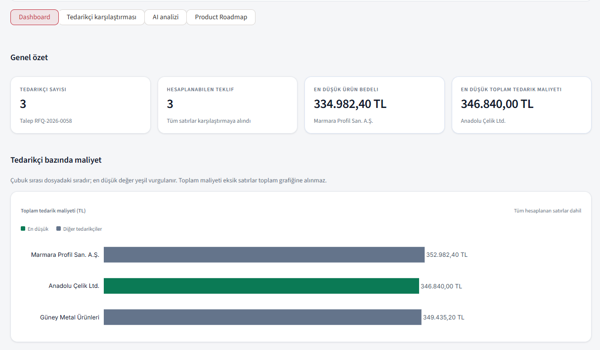
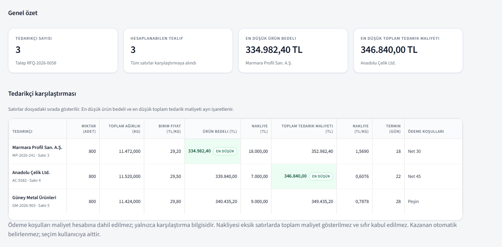
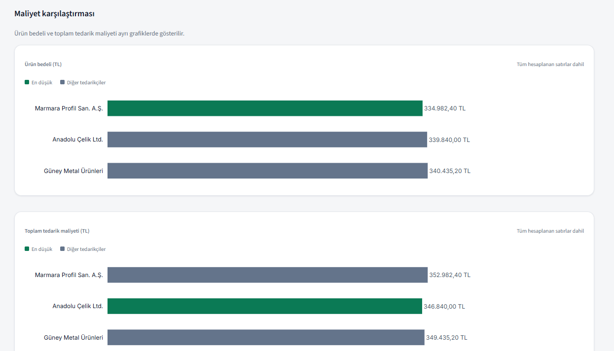
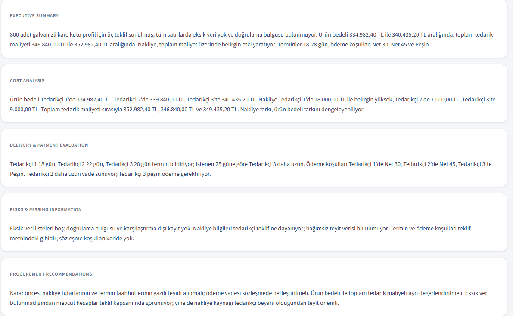
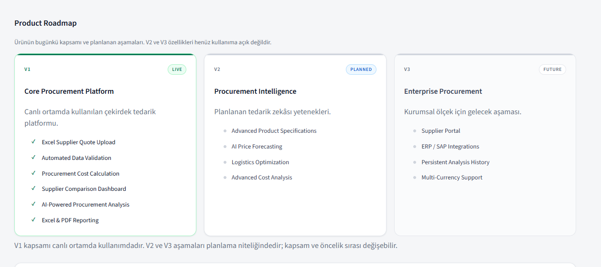
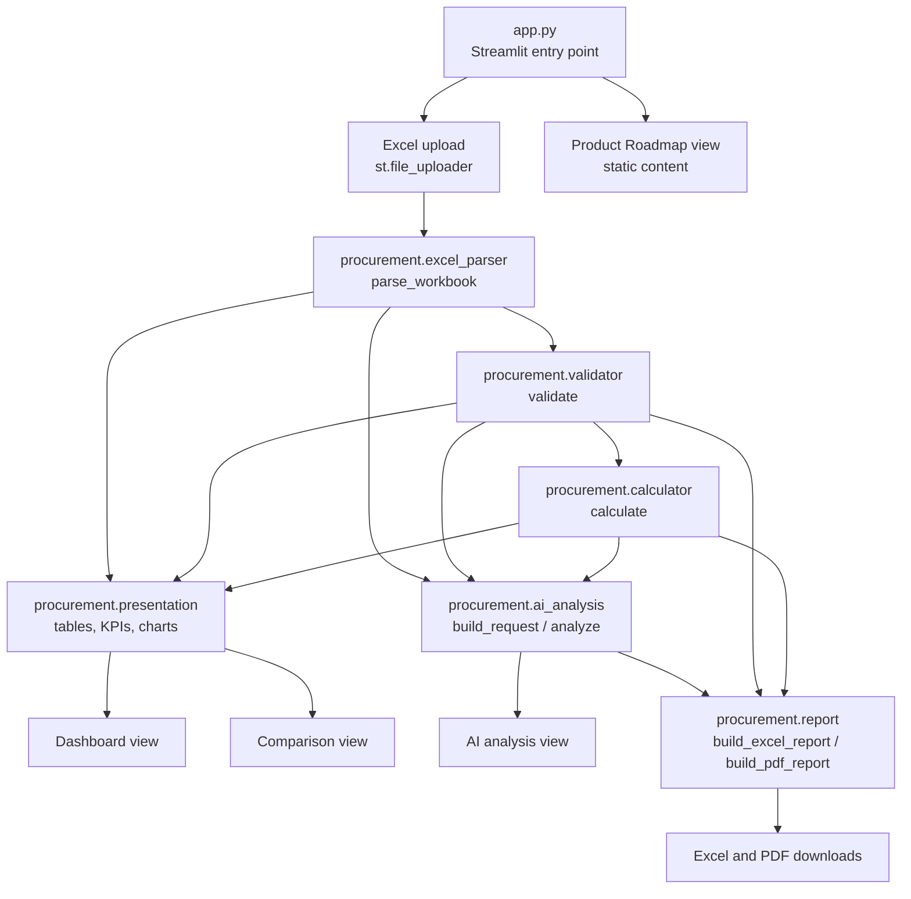

# AI Procurement Intelligence

**English** | [Türkçe](README.tr.md)


> **Live demo:** [Open AI Procurement Intelligence](https://ai-procurement-intelligence-ks3d3w9xqgfqv3mpc36uka.streamlit.app/)  
> **Source code:** [GitHub repository](https://github.com/mertkk1623/ai-procurement-intelligence)


A Streamlit application that turns supplier quotations into one verified, comparable cost baseline — deterministic calculation first, optional AI interpretation second.

---

## Table of Contents

- [Project Overview](#project-overview)
- [Key Features](#key-features)
- [Application Screenshots](#application-screenshots)
- [How It Works](#how-it-works)
- [Technology Stack](#technology-stack)
- [Architecture](#architecture)
- [Installation and Setup](#installation-and-setup)
- [Deployment](#deployment)
- [Roadmap](#roadmap)
- [Calculation Principles](#calculation-principles)
- [Limitations](#limitations)
- [License](#license)

---

## Project Overview

Procurement teams receive quotations that are difficult to compare directly. Suppliers report weight per metre, unit price, shipping cost, delivery time and payment terms in different formats, with missing fields and occasional inconsistencies. Comparing them in ad-hoc spreadsheets is slow, hard to reproduce, and the reasoning behind a decision is rarely documented.

AI Procurement Intelligence standardises this step for a single, fixed product category — hot-dip galvanised square steel hollow section, 40 × 40 × 2 mm, 6 m — and a single currency (TRY). The user fills in one Excel template, uploads it, and receives:

- a validation report listing blocking errors, warnings and missing-information requests;
- deterministic cost calculations (product cost, shipping, total supply cost) produced in Python, not in Excel;
- a side-by-side supplier comparison with the lowest product cost and the lowest total supply cost marked separately;
- Excel and PDF reports that record the figures, assumptions and validation findings;
- an optional AI-written interpretation of the already calculated results.

The application deliberately separates two responsibilities:

- **The calculation engine** produces every number. It is pure Python, deterministic, and covered by unit tests.
- **The AI layer** only explains and contextualises those numbers. It does not calculate costs, rank suppliers, or select a winner.

The interface language is Turkish; the codebase, tests and documentation use Turkish domain terms alongside English identifiers.

---

## Key Features

All items below are implemented and verified in the current source code.

| Feature | What it does |
|---|---|
| **Excel quotation template** | A ready-made `.xlsx` template (`templates/supplier_quote_template.xlsx`, template version 1.0) with `Instructions`, `RFQ` and `Supplier Quotes` sheets and 14 quotation columns. Downloadable directly from the start screen. |
| **Excel upload and parsing** | Accepts `.xlsx` files up to 5 MB, opens the workbook with `data_only=False`, rejects formula cells instead of trusting cached values, and reports structural problems (missing sheets, missing or duplicate headers, missing fields, unsupported format). |
| **Data validation** | A rule catalogue of 46 codes — 29 blocking errors, 16 warnings, 1 information request — covering template version, profile specification, length, currency, quantity, weight, price, shipping source, payment terms, quote validity, duplicate suppliers, names and number formatting. |
| **Deterministic cost calculation** | `Decimal`-based engine computing total length, total weight, product cost, shipping per kg and total supply cost. No VAT is applied anywhere. Missing shipping is never treated as zero. |
| **Supplier comparison dashboard** | KPI cards, a per-supplier cost chart, an analysis summary card, and a comparison view with a full table, two cost charts, validation findings panels and a list of excluded rows. |
| **KPI and chart visualisations** | Four KPI cards (supplier count, calculable quotations, lowest product cost, lowest total supply cost) and Plotly horizontal bar charts. Row order follows the source file; the chart does not produce a ranking. |
| **AI-powered procurement analysis** | Optional, user-triggered interpretation of the calculated results through an OpenAI-compatible endpoint. Five fixed sections. Supplier names are masked before the request; numeric claims in the response are verified against source figures. |
| **Excel report generation** | `Yönetici Özeti`, `Tedarikçi Karşılaştırma` and `Doğrulama` sheets, plus an `AI Yorumu` sheet when an analysis exists in the session. |
| **PDF report generation** | A4 ReportLab document with request metadata, an executive summary, a comparison table, a cost evaluation, a delivery and payment table, validation findings and method notes. The AI section is appended only when an analysis exists. |
| **Product roadmap interface** | A static fourth view presenting V1 (live), V2 (planned) and V3 (future) as a three-stage roadmap. It is presentational only. |

### What the AI layer does not do

The AI analysis is an explanation layer, not a decision layer:

- It does not compute, estimate or round any cost figure. All amounts are read from `procurement.calculator`.
- It does not produce a supplier ranking or select a winning bid.
- It never receives the raw Excel file, the notes column, quote numbers or real supplier names. Payment terms are forwarded as typed, which is why that cell should not contain identifiers (see [Limitations](#limitations)).
- If its response contains a number that cannot be matched to the verified source figures, the analysis is rejected and not displayed.

---

## Application Screenshots

The screenshots below were captured from the running application using a demonstration workbook with three supplier quotations. That workbook is not part of the repository; the supplier names it contains are illustrative.

The figures in the screenshots are mutually consistent: 800 pcs × 6 m × 2,39 kg/m = 11.472 kg, and 11.472 kg × 29,20 TL/kg = 334.982,40 TL, plus 18.000,00 TL shipping = 352.982,40 TL.

### Dashboard


### Supplier comparison


### Cost charts


### AI analysis


### Product roadmap


### Sample reports

Both reports were produced by the application from the same demonstration workbook, with an AI analysis included.

| File | Contents |
|---|---|
| [`sample-procurement-report.xlsx`](docs/sample-reports/sample-procurement-report.xlsx) | Four sheets: `Yönetici Özeti`, `Tedarikçi Karşılaştırma`, `Doğrulama`, `AI Yorumu` |
| [`sample-procurement-report.pdf`](docs/sample-reports/sample-procurement-report.pdf) | Two A4 pages: metadata table, executive summary, comparison table, cost evaluation, delivery and payment terms, validation findings, method notes and the AI section |

---

## How It Works

The workflow below matches the current implementation in `app.py`.

1. **Download the Excel template.**
   On the start screen, `st.download_button` serves `templates/supplier_quote_template.xlsx` as `tedarikci-teklif-sablonu.xlsx`. If the file cannot be read, the app shows a readable warning instead of a button.

2. **Enter supplier quotation information.**
   One quotation per supplier row on the `Supplier Quotes` sheet (rows 3–102, 14 columns): supplier name, quote number, profile specification, length, quantity, weight (kg/m), unit price (TRY/kg, excl. VAT), shipping cost, shipping cost source, delivery days, payment terms, quote date, quote validity and notes. The `Instructions` sheet requires an explicit VAT-exclusive declaration in cell `B4` (`EVET`); the bundled template ships with `B4 = HAYIR`, so the declaration has to be changed deliberately. Without it the file is rejected with `E-DECL-01`.

3. **Upload the completed workbook.**
   `st.file_uploader` accepts `.xlsx` only. The payload is written to a temporary directory, parsed, validated and calculated, and the temporary file is deleted immediately afterwards. Nothing is persisted.

4. **Validate the uploaded data.**
   `parse_workbook` reads the workbook structurally, then `validate` produces typed findings. Blocking errors remove a row from comparison; warnings inform without stopping; information requests (for example missing shipping) do not block calculation, but the summary status reports the data as incomplete. A file-level error rejects the whole file and no row is calculated.

5. **Review calculated procurement costs.**
   `calculate` produces one row per accepted quotation with total length, total weight, product cost, shipping, shipping per kg and total supply cost. The dashboard shows the KPIs, a cost chart and a summary card.

6. **Compare supplier quotations.**
   The comparison view renders the full table, two charts (product cost and total supply cost), grouped validation findings and the excluded rows with their reasons and codes.

7. **Generate AI-assisted procurement analysis.**
   The AI view is opt-in: nothing is sent until the user presses **AI analizini oluştur**. The request carries the calculated figures, the masked supplier labels (`Tedarikçi N`), the validation findings, the excluded rows, the delivery location, the requested lead time, the delivery days and the payment-terms text of each supplier. Notes, quote numbers and the file name are not sent. The analysis is kept in session state against an analysis signature (file signature, calculated row count, lowest-cost marks, finding codes) and is cleared as soon as that signature changes.

8. **Export Excel or PDF reports.**
   Both reports are generated in memory on each render and offered as downloads. They are never written to disk, and the AI section appears only if an analysis was produced in the same session.

---

## Technology Stack

Taken from `requirements.txt` and the actual imports in the source code.

| Layer | Technology | Version |
|---|---|---|
| Language | Python | 3.11+ required by the pinned libraries; the development `.venv` runs Python 3.15.2 |
| Web interface | Streamlit | 1.67.0 |
| Excel reading/writing | OpenPyXL | 3.1.5 |
| Charts | Plotly (`plotly.graph_objects`) | 7.1.0 |
| PDF generation | ReportLab | 5.1.0 |
| AI client | OpenAI Python SDK against an OpenAI-compatible endpoint | 3.49.0 |
| Environment variables | python-dotenv | 1.2.4 |
| Testing | pytest | 9.2.0 |

**Default AI configuration** (in `src/procurement/ai_analysis.py`):

- Base URL: `https://api-cdn.deploy.com/api/v1` (overridable with `DEPLOY_BASE_URL`)
- Model: `deepseek-ai/deepseek-v4.1-flash-1017` (overridable with `DEPLOY_MODEL`)
- Timeout: 90 seconds, one retry

`pandas` is pinned in `requirements.txt` (3.1.1) as part of the declared dependency set, but no current module imports it: Excel access uses OpenPyXL directly. This is stated here so the technology list reflects the code rather than the dependency file alone.

No database driver, ORM, authentication library, CSS framework or JavaScript build tool is used.

---

## Architecture

The application is a thin Streamlit presentation layer over a pure Python package in `src/procurement/`. The calculation and validation layers have no Streamlit imports, so they are testable without a UI.



### Repository layout

```
ai-procurement-intelligence/
├── app.py                          # Streamlit entry point: layout, views, wiring
├── requirements.txt                # Pinned direct dependencies
├── pytest.ini                      # Test discovery, src on PYTHONPATH, markers
├── opencode.json                   # Editor/agent configuration (not used at runtime)
├── .gitignore                      # Excludes .env, secrets.toml, .venv, caches
├── .github/
│   └── workflows/
│       └── tests.yml               # CI: pytest on Python 3.11, 3.12 and 3.13
├── docs/
│   ├── PROJECT_BRIEF.md            # Product scope, calculation rules, AI limits
│   ├── EXCEL_TEMPLATE_SPEC.md      # Template structure and validation catalogue
│   ├── images/                     # Screenshots used in this README
│   │   ├── 01-dashboard.png
│   │   ├── 02-supplier-comparison.png
│   │   ├── 03-cost-charts.png
│   │   ├── 04-ai-analysis-results.png
│   │   └── 05-product-roadmap.png
│   └── sample-reports/             # Sample outputs generated by the app
│       ├── sample-procurement-report.pdf
│       └── sample-procurement-report.xlsx
├── templates/
│   └── supplier_quote_template.xlsx  # Downloadable quotation template
├── src/procurement/
│   ├── __init__.py                 # Package metadata (version 0.1.0)
│   ├── excel_parser.py             # Read-only workbook parsing and structure checks
│   ├── validator.py                # Rule catalogue and findings
│   ├── calculator.py               # Deterministic Decimal cost engine
│   ├── presentation.py             # View models, formatting, KPI and chart builders
│   ├── ai_analysis.py              # Masked request builder and AI response validation
│   └── report.py                   # Excel and PDF report builders
└── tests/                          # 471 tests across 8 files
```

### Module responsibilities

| Module | Responsibility |
|---|---|
| `app.py` | Page configuration, global CSS, file upload, view dispatch (`Dashboard`, `Tedarikçi karşılaştırması`, `AI analizi`, `Product Roadmap`), report section. Delegates every calculation. |
| `procurement/excel_parser.py` | Opens the workbook with `data_only=False`, reads template metadata, RFQ fields and supplier rows, rejects formula cells, and raises typed exceptions (`UnsupportedFormatError`, `FileTooLargeError`, `MissingSheetError`, `MissingHeaderError`, `DuplicateHeaderError`, `MissingFieldError`, `DuplicateFieldError`, `VatDeclarationError`, `FormulaCellError`). The app calls it with `strict=False`, so missing sheets and headers are reported as validation findings instead of exceptions; `strict=True` is the default for direct use. |
| `procurement/validator.py` | Applies the 46-code catalogue, returns `Finding` objects with severity, row/cell/field context and `ValidationResult`. Also derives payment days from payment-terms text. |
| `procurement/calculator.py` | Produces `SupplierCalculation` rows, excluded rows, and the two `CostMark` objects for lowest product cost and lowest total supply cost. Uses `Decimal` with `ROUND_HALF_UP` at output precision only. |
| `procurement/presentation.py` | Converts engine output into display models: comparison rows, KPI cards, summary card, Plotly figure, grouped findings, excluded row views, rejection hints. Formats money, weight, rate, quantity and days in Turkish notation. |
| `procurement/ai_analysis.py` | Builds the masked payload, calls the OpenAI-compatible endpoint, parses the five-section response, and rejects any response containing unverified numeric figures. |
| `procurement/report.py` | Builds the `.xlsx` workbook in memory and the A4 PDF with ReportLab. Both accept an optional AI analysis. |

### Error handling

The parser raises one exception hierarchy whose messages are user-facing and free of filesystem paths or technical detail; the original exception remains available as `__cause__` for debugging. Validation findings carry stable codes rather than free-form text, so they can be grouped, filtered and reused in reports.

### Testing

`pytest.ini` sets `testpaths = tests`, `pythonpath = src` and declares two markers, `unit` and `integration`.

| Test file | Focus |
|---|---|
| `tests/test_excel_parser.py` | Structure, headers, formula cells, file limits, source-file immutability |
| `tests/test_validator.py` | Rule catalogue, severities, payment-day derivation |
| `tests/test_calculator.py` | Cost formulas, missing shipping, rounding, lowest-cost marks |
| `tests/test_presentation.py` | Formatting, tables, KPIs, chart data, summary text |
| `tests/test_ai_analysis.py` | Payload masking, numeric verification, error kinds |
| `tests/test_report.py` | Excel sheets and PDF structure |
| `tests/test_app.py` | Streamlit views through `AppTest`, including navigation and roadmap |
| `tests/test_smoke.py` | Package import and version |

Current state: **471 tests**, of which 331 are marked `unit` and 137 `integration`; three smoke tests carry no marker.

### Continuous integration

`.github/workflows/tests.yml` runs the full suite on every push and pull request:

- Ubuntu runner, three parallel jobs for Python 3.11, 3.12 and 3.13 (`fail-fast: false`, so one version failing does not cancel the others);
- dependencies installed from `requirements.txt` with the `pip` cache keyed on that file;
- `python -m pytest -q` as the only test command, relying on `pythonpath = src` from `pytest.ini` — no `PYTHONPATH` override;
- `PYTHONUTF8=1` and `PYTHONIOENCODING=utf-8` so the Turkish test names and assertion messages are read consistently;
- a 15-minute job timeout and cancel-in-progress concurrency per branch.

No API key is needed: the AI tests inject a fake client (`_FakeClient`), so the suite never reaches the network.

---

## Installation and Setup

### Prerequisites

- Windows 10/11, macOS or Linux
- Python 3.11 or newer
- Git

### Steps (PowerShell on Windows)

```powershell
git clone https://github.com/mertkk1623/ai-procurement-intelligence.git
cd ai-procurement-intelligence

python -m venv .venv
.\.venv\Scripts\Activate.ps1

python -m pip install --upgrade pip
pip install -r requirements.txt
```

If PowerShell blocks the activation script, allow it for the current session first:

```powershell
Set-ExecutionPolicy -Scope Process -ExecutionPolicy Bypass
```

On macOS or Linux, replace the activation step with:

```bash
source .venv/bin/activate
```

### Configure the optional AI key

The application runs without any API key; only the AI analysis view requires one. The key is read from the `DEPLOY_API_KEY` environment variable, and `.env` is loaded with `override=False` so an existing environment variable always wins.

Create `.streamlit/secrets.toml` — already excluded by `.gitignore`:

```toml
DEPLOY_API_KEY = "your_api_key_here"
```

Or create `.env` in the project root:

```
DEPLOY_API_KEY=your_api_key_here
```

Optional overrides:

```toml
DEPLOY_BASE_URL = "https://api-cdn.deploy.com/api/v1"
DEPLOY_MODEL = "deepseek-ai/deepseek-v4.1-flash-1017"
```

Without a key, the AI view displays a configuration notice stating that `DEPLOY_API_KEY` is missing and that all other features continue to work. No API call is attempted.

### Run the application

```powershell
streamlit run app.py
```

The app opens on the start screen with the template download button.

### Run the tests

```powershell
pytest -q                # full suite
pytest -m unit -q        # unit tests only
pytest -m integration -q # integration tests only
```

`pytest.ini` already puts `src` on the import path, so no `PYTHONPATH` setup is needed.

---

## Deployment

The application is a standard Streamlit app with no database, no background worker and no build step, so Streamlit Community Cloud can host it directly.

1. **Push the repository to GitHub.**
   The app entry point is `app.py` at the repository root.

2. **Create a new app on Streamlit Community Cloud.**
   Connect the GitHub account, select the repository and the branch that contains the code (`master` in this project).

3. **Set the main file path.**
   Enter `app.py`.

4. **Configure secrets.**
   In the app's *Settings → Secrets* panel, add:

   ```toml
   DEPLOY_API_KEY = "your_api_key_here"
   ```

   Streamlit exposes top-level string secrets as environment variables, and the application reads `DEPLOY_API_KEY` from the environment. Secrets are never committed: `.streamlit/secrets.toml` and `.env` are both git-ignored.

5. **Deploy and verify.**
   After deployment, the start screen must show the template download button. Upload the template filled with `Instructions!B4 = EVET` to confirm the full pipeline.

The bundled template is resolved relative to the app file (`Path(__file__).resolve().parent / "templates" / "supplier_quote_template.xlsx"`), so it works from the deployed working directory without absolute paths. `requirements.txt` is pinned, which keeps the cloud build reproducible.

No secrets, tokens or credentials belong in this repository. If the AI key is omitted, the deployment still works and only the AI view shows the configuration notice.

---

## Roadmap

The roadmap is also visible inside the application as a static fourth view. V2 and V3 are **not implemented**; they are planning statements.

### V1 — Core Procurement Platform


- Excel supplier quotation upload
- Automated data validation
- Procurement cost calculation
- Supplier comparison dashboard
- AI-powered procurement analysis
- Excel and PDF reporting

### V2 — Procurement Intelligence


- Advanced product specifications
- AI price forecasting
- Logistics optimization
- Advanced cost analysis

### V3 — Enterprise Procurement


- Supplier portal
- ERP / SAP integrations
- Persistent analysis history
- Multi-currency support

---

## Calculation Principles

These rules are enforced in `src/procurement/calculator.py` and `src/procurement/validator.py`, and asserted in the test suite.

| Principle | Implementation |
|---|---|
| **VAT is excluded** | No VAT rate, amount or gross total exists in the template, engine or reports. Every amount is VAT-exclusive TRY. The template requires an explicit user declaration (`Instructions!B4`) before processing. |
| **Single currency** | `TRY` is fixed (`EXPECTED_CURRENCY = "TRY"`). Any other currency is a blocking error (`E-CUR-01`). |
| **Missing shipping stays missing** | An empty shipping cell is not zero. Product cost is still computed, but shipping per kg and total supply cost remain `None`, the row records the missing field in `missing_data` (`MISSING_SHIPPING`), and an information request (`I-SHIP-01`) asks for the amount or an explicit assumption. |
| **Product cost and total supply cost are separate** | `product_cost_try = total_weight × unit_price`; `total_supply_cost_try = product_cost + shipping`. Both are marked independently, and they may point to different suppliers. |
| **No automatic winner or ranking** | Rows stay in source order. `CostMark` records the lowest value and the rows reaching it, nothing else. There is no weighted score, composite score or sorting algorithm. |
| **Payment terms do not affect cost** | Payment terms are preserved as original text; payment days are derived separately (cash = 0, `Net N` = N, mixed terms = empty). Neither changes any amount or position. |
| **Weight comes from the supplier** | Calculations use the supplier-declared kg/m. The theoretical reference 2.39 kg/m with ±5% tolerance (2.27–2.51 kg/m) only triggers a warning; the value is never corrected. |
| **Deterministic arithmetic** | All money is computed with `Decimal`. Intermediate steps are unrounded, and output rounding uses `ROUND_HALF_UP`: money to 2 decimals, weight and length to 3, shipping per kg to 4. |
| **AI interprets, never calculates** | The AI payload is built from `CalculationResult` values. Numeric statements in the response are compared against the source figures; any mismatch rejects the whole analysis. |
| **Supplier identities are masked** | `build_request` replaces supplier names with `Tedarikçi 1…N` and excluded rows with `Karşılaştırma dışı 1…N`. Notes, quote numbers and the file name are not sent. The label-to-name mapping stays in the UI. |

Formula summary:

```
total_length_m      = quantity_pcs × 6
total_weight_kg     = quantity_pcs × 6 × weight_kg_per_m
product_cost_try    = total_weight_kg × unit_price_try_per_kg
shipping_per_kg_try = shipping_cost_try ÷ total_weight_kg
total_supply_cost   = product_cost_try + shipping_cost_try
```

---

## Limitations

Verified current limitations:

- **Single product only.** The template is fixed to the 40 × 40 × 2 mm, 6 m galvanised hollow section with product code `KUTUPROFIL-40X40X2-GALV`. A different specification is a blocking error, not a supported comparison.
- **Single currency only.** TRY, VAT-exclusive. No conversion, no exchange-rate handling.
- **No database or persistent storage.** No ORM or database driver is present. Uploaded files are parsed in a temporary directory and deleted within the same request; reports are generated in memory.
- **No user accounts or authentication.** Anyone with the URL can use the deployed app; there is no login, role or permission layer.
- **No analysis history.** Results live in Streamlit session state and disappear when the session ends. AI output is held only for the current analysis signature and is discarded as soon as the uploaded file, the calculated rows, the lowest-cost marks or the finding codes change.
- **No payment functionality.** No invoicing, ordering, approval or payment integration exists.
- **No ERP or SAP integration.** No external procurement system is called.
- **No PDF chart image.** The PDF contains tables and text sections; the Plotly chart is not rendered into the PDF (no image export dependency such as `kaleido` is installed).
- **PDF comparison table wraps long values.** The narrow weight column holds a 3-decimal figure, so `11.472,000` is laid out as `11.472,00` on one line and `0` on the next. The value is correct; only the cell layout wraps, as visible in the [sample PDF](docs/sample-reports/sample-procurement-report.pdf).
- **No automated supplier ranking or award decision.** The interface shows figures and marks extremes; the choice remains with the user.
- **Turkish-only user interface.** All working views are in Turkish; the static Product Roadmap view keeps English stage titles and status labels. Code identifiers and test names use Turkish domain terms alongside English.
- **Template download depends on the bundled file.** If `templates/supplier_quote_template.xlsx` is missing or unreadable, the app shows a warning instead of a download button.
- **AI depends on an external service.** Without a valid `DEPLOY_API_KEY`, or if the endpoint is unreachable, the AI view is unavailable; all other features remain functional.
- **AI payload scope.** Supplier names, notes, quote numbers and the file name are excluded from the AI request, but the payment-terms cell is sent as typed. That cell is free text and may contain an identifier the user entered; it is not masked.
- **Screenshot coverage.** Five screenshots are included: dashboard, supplier comparison, cost charts, AI analysis and product roadmap. The start/upload screen and the report download section are not captured.
- **Sample data is illustrative only.** The demonstration workbook behind the screenshots and the sample reports is not committed; the supplier names and figures in those files are examples, not real quotations.

---

## License

**No license has been specified for this project.**

No `LICENSE` file exists in the repository. Absence of a license means the default copyright rules apply; the code is not offered under an open-source license unless one is added.
