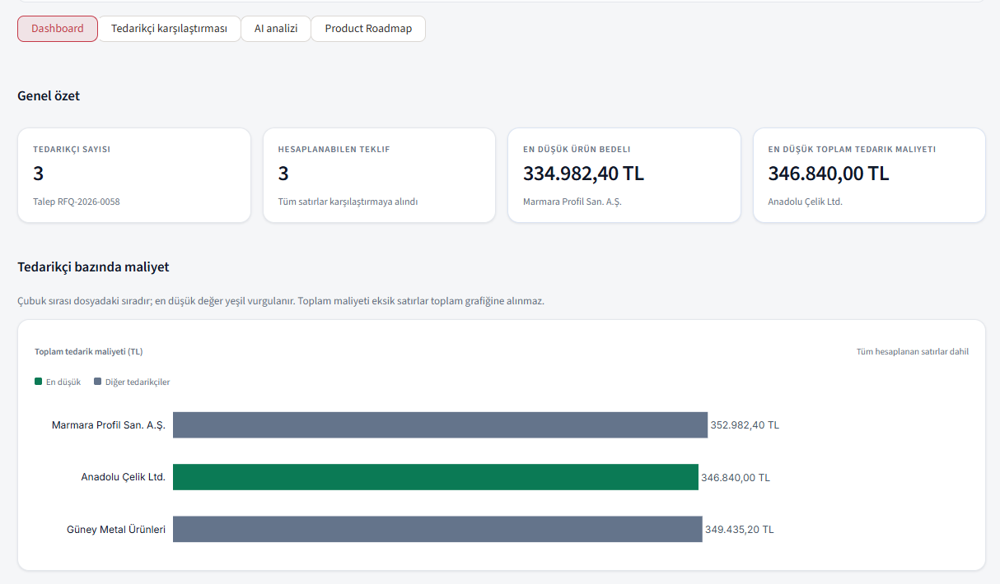
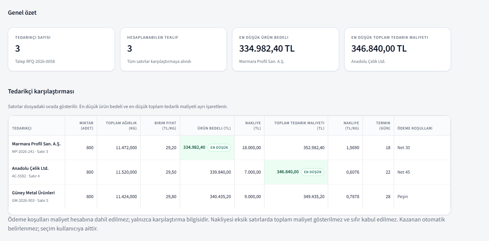
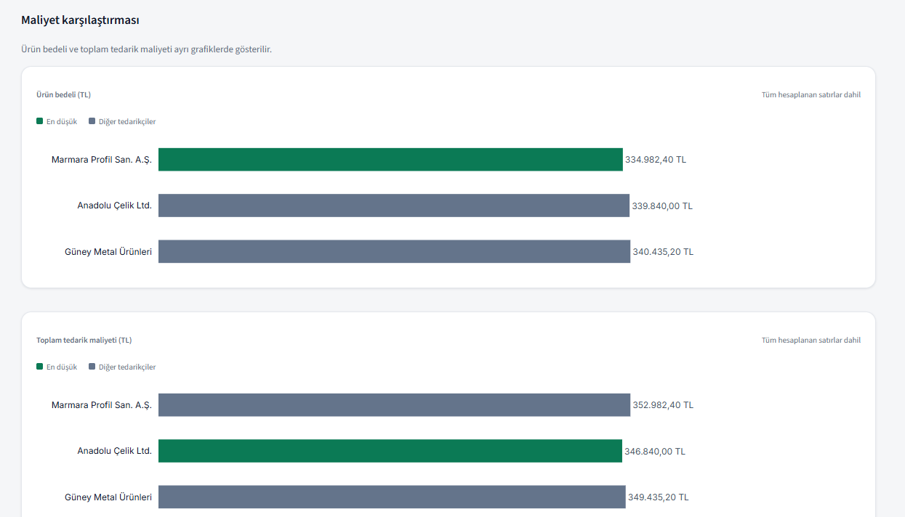
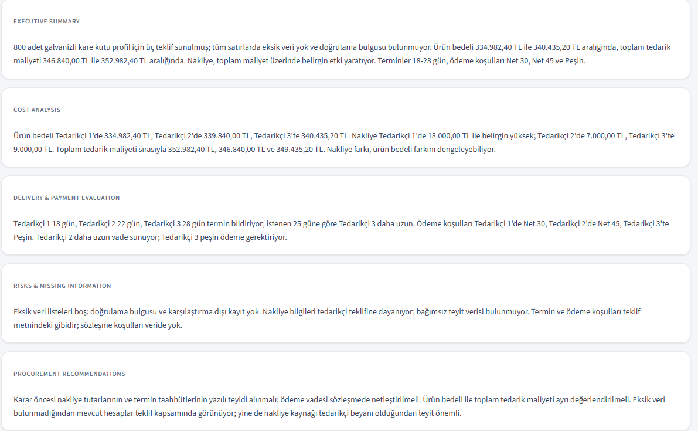
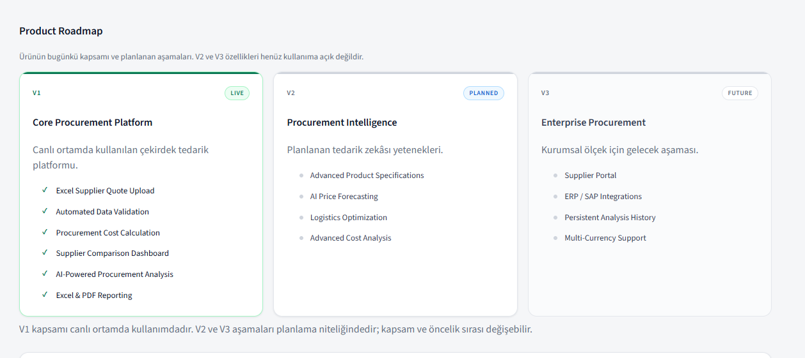
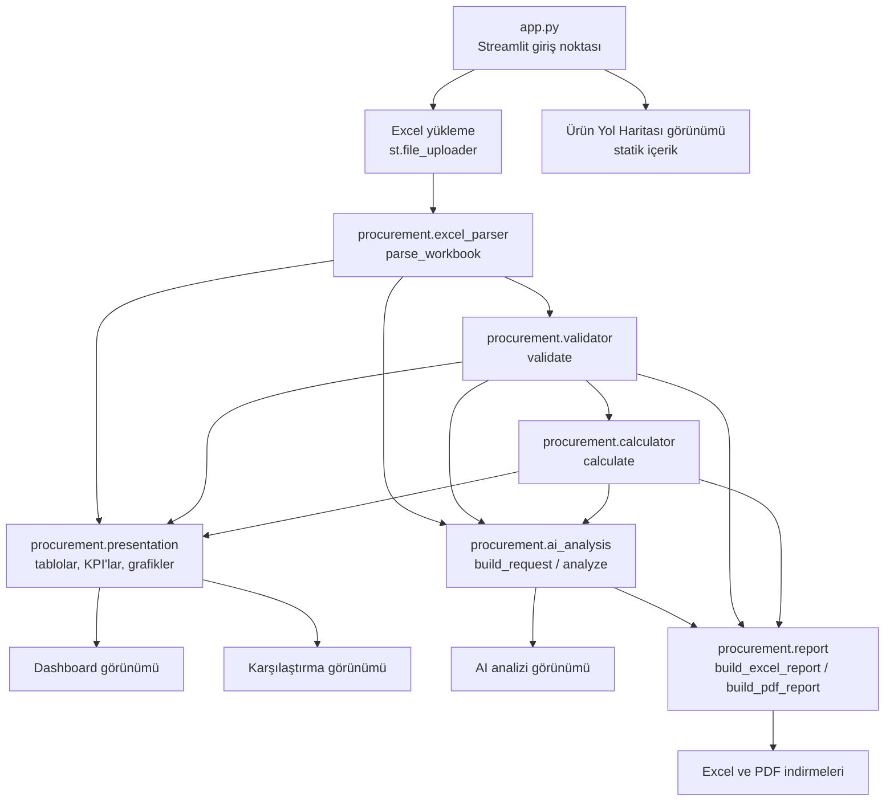

# Yapay Zekâ Destekli Satın Alma İstihbaratı

[English](README.md) | **Türkçe**


> **Canlı demo:** [AI Procurement Intelligence uygulamasını aç](https://ai-procurement-intelligence-ks3d3w9xqgfqv3mpc36uka.streamlit.app/)  
> **Kaynak kodlar:** [GitHub deposu](https://github.com/mertkk1623/ai-procurement-intelligence)


Tedarikçi tekliflerini tek ve doğrulanmış bir maliyet tabanına dönüştüren Streamlit uygulaması — önce deterministik hesaplama, sonra isteğe bağlı yapay zekâ yorumu.

---

## İçindekiler

- [Proje Hakkında](#proje-hakkında)
- [Temel Özellikler](#temel-özellikler)
- [Uygulama Ekran Görüntüleri](#uygulama-ekran-görüntüleri)
- [Nasıl Çalışır?](#nasıl-çalışır)
- [Teknoloji Altyapısı](#teknoloji-altyapısı)
- [Mimari](#mimari)
- [Kurulum ve Yapılandırma](#kurulum-ve-yapılandırma)
- [Yayına Alma](#yayına-alma)
- [Yol Haritası](#yol-haritası)
- [Hesaplama İlkeleri](#hesaplama-ilkeleri)
- [Mevcut Sınırlamalar](#mevcut-sınırlamalar)
- [Lisans](#lisans)

---

## Proje Hakkında

Satın alma ekiplerine gelen tedarikçi teklifleri doğrudan karşılaştırılamaz. Tedarikçiler metre başına ağırlığı, birim fiyatı, nakliye bedelini, teslimat süresini ve ödeme koşullarını farklı biçimlerde bildirir; alanlar eksik kalır, tutarsızlıklar ortaya çıkar. Bu karşılaştırmayı Excel'de elle yapmak yavaştır, tekrarlanamaz ve kararın gerekçesi çoğu zaman belgelenmez.

Yapay Zekâ Destekli Satın Alma İstihbaratı bu adımı tek bir sabit ürün ve tek para birimi için standartlaştırır: sıcak daldırma galvanizli kare çelik kutu profil, 40 × 40 × 2 mm, 6 m ve TRY. Kullanıcı tek bir Excel şablonu doldurur, yükler ve şunları elde eder:

- bloklayıcı hataları, uyarıları ve bilgi taleplerini listeleyen doğrulama raporu;
- Excel'de değil, Python tarafında üretilen deterministik maliyet hesapları (ürün bedeli, nakliye, toplam tedarik maliyeti);
- en düşük ürün bedelini ve en düşük toplam tedarik maliyetini ayrı ayrı işaretleyen yan yana tedarikçi karşılaştırması;
- tutarları, varsayımları ve doğrulama bulgularını kaydeden Excel ve PDF raporları;
- isteğe bağlı olarak, hesaplanmış sonuçların yapay zekâ ile yorumu.

Uygulama iki sorumluluğu bilinçli olarak ayırır:

- **Hesaplama motoru** her sayıyı üretir. Saf Python'dur, deterministiktir ve birim testleriyle kapsanmıştır.
- **Yapay zekâ katmanı** yalnızca bu sayıları açıklar ve bağlamlandırır. Maliyet hesaplamaz, tedarikçi sıralamaz, kazanan seçmez.

Arayüz dili Türkçe'dir; kod, testler ve dokümantasyon İngilizce tanımlayıcılarla birlikte Türkçe alan terimlerini kullanır.

---

## Temel Özellikler

Aşağıdaki maddelerin tamamı mevcut kaynak kodda uygulanmış ve doğrulanmıştır.

| Özellik | Ne yapar |
|---|---|
| **Excel teklif şablonu** | `Instructions`, `RFQ` ve `Supplier Quotes` sayfalarından ve 14 teklif sütunundan oluşan hazır `.xlsx` şablonu (`templates/supplier_quote_template.xlsx`, şablon sürümü 1.0). Başlangıç ekranından doğrudan indirilebilir. |
| **Excel yükleme ve ayrıştırma** | 5 MB'a kadar `.xlsx` kabul eder, çalışma kitabını `data_only=False` ile açar, önbelleğe alınmış değerlere güvenmek yerine formül hücrelerini reddeder ve yapısal sorunları bildirir (eksik sayfa, eksik veya mükerrer başlık, eksik alan, desteklenmeyen biçim). |
| **Veri doğrulama** | 46 kodlu kural kataloğu — 29 bloklayıcı hata, 16 uyarı, 1 bilgi talebi. Şablon sürümü, profil ölçüsü, uzunluk, para birimi, miktar, ağırlık, fiyat, nakliye kaynağı, ödeme koşulları, teklif geçerliliği, mükerrer tedarikçi, adlar ve sayı biçimi kapsanır. |
| **Deterministik maliyet hesabı** | `Decimal` tabanlı motor; toplam uzunluk, toplam ağırlık, ürün bedeli, kg başına nakliye ve toplam tedarik maliyetini hesaplar. Hiçbir aşamada KDV uygulanmaz. Eksik nakliye asla sıfır sayılmaz. |
| **Tedarikçi karşılaştırma paneli** | KPI kartları, tedarikçi bazında maliyet grafiği, analiz özeti kartı; ayrıca tam tablo, iki maliyet grafiği, doğrulama bulguları panelleri ve karşılaştırma dışı satır listesi içeren karşılaştırma görünümü. |
| **KPI ve grafik görselleştirmeleri** | Dört KPI kartı (tedarikçi sayısı, hesaplanabilen teklif, en düşük ürün bedeli, en düşük toplam tedarik maliyeti) ve Plotly yatay çubuk grafikleri. Satır sırası kaynak dosyadaki sıradır; grafik sıralama üretmez. |
| **Yapay zekâ destekli satın alma analizi** | İsteğe bağlı, kullanıcı tetiklemeli yorum. OpenAI uyumlu uç nokta üzerinden çalışır, beş sabit bölüm üretir. Tedarikçi adları istekten önce maskelenir; yanıttaki sayısal ifadeler kaynak verilerle doğrulanır. |
| **Excel raporu** | `Yönetici Özeti`, `Tedarikçi Karşılaştırma` ve `Doğrulama` sayfaları; oturumda analiz varsa ek olarak `AI Yorumu` sayfası. |
| **PDF raporu** | Talep bilgileri, yönetici özeti, karşılaştırma tablosu, maliyet değerlendirmesi, teslimat ve ödeme tablosu, doğrulama bulguları ve yöntem notlarını içeren A4 ReportLab belgesi. AI bölümü yalnızca analiz varsa eklenir. |
| **Ürün yol haritası arayüzü** | V1 (canlı), V2 (planlı) ve V3 (gelecek) aşamalarını üç aşamalı yol haritası olarak sunan statik dördüncü görünüm. Yalnızca sunum amaçlıdır. |

### Yapay zekâ katmanının yapmadıkları

Yapay zekâ analizi bir karar katmanı değil, açıklama katmanıdır:

- Hiçbir maliyeti hesaplamaz, tahmin etmez veya yuvarlamaz. Tüm tutarlar `procurement.calculator` çıktısından okunur.
- Tedarikçi sıralaması üretmez, kazanan teklifi seçmez.
- Ham Excel dosyasını, notlar sütununu, teklif numaralarını veya gerçek tedarikçi adlarını hiçbir zaman almaz. Ödeme koşulları girildiği biçimde iletilir; bu nedenle o hücreye tanımlayıcı yazılmamalıdır (bkz. [Mevcut Sınırlamalar](#mevcut-sınırlamalar)).
- Yanıtında doğrulanmış kaynak sayılarla eşleşmeyen bir sayı bulunursa analiz reddedilir ve gösterilmez.

---

## Uygulama Ekran Görüntüleri

Aşağıdaki ekran görüntüleri, üç tedarikçi teklifi içeren bir gösterim çalışma kitabıyla çalışan uygulamadan alınmıştır. Bu çalışma kitabı depoda yer almaz; içerdiği tedarikçi adları örnektir.

Görüntülerdeki sayılar birbiriyle tutarlıdır: 800 adet × 6 m × 2,39 kg/m = 11.472 kg ve 11.472 kg × 29,20 TL/kg = 334.982,40 TL; 18.000,00 TL nakliye ile toplam 352.982,40 TL.

### Dashboard


### Tedarikçi karşılaştırması


### Maliyet grafikleri


### Yapay zekâ analizi


### Ürün yol haritası


### Örnek raporlar

Her iki rapor da uygulama tarafından aynı gösterim çalışma kitabından, AI analizi dahil edilerek üretilmiştir.

| Dosya | İçerik |
|---|---|
| [`sample-procurement-report.xlsx`](docs/sample-reports/sample-procurement-report.xlsx) | Dört sayfa: `Yönetici Özeti`, `Tedarikçi Karşılaştırma`, `Doğrulama`, `AI Yorumu` |
| [`sample-procurement-report.pdf`](docs/sample-reports/sample-procurement-report.pdf) | İki A4 sayfa: üst veri tablosu, yönetici özeti, karşılaştırma tablosu, maliyet değerlendirmesi, teslimat ve ödeme koşulları, doğrulama bulguları, yöntem notları ve AI bölümü |

---

## Nasıl Çalışır?

Aşağıdaki akış `app.py` içindeki mevcut uygulamayla birebir eşleşir.

1. **Excel şablonunu indirin.**
   Başlangıç ekranında `st.download_button`, `templates/supplier_quote_template.xlsx` dosyasını `tedarikci-teklif-sablonu.xlsx` adıyla sunar. Dosya okunamazsa buton yerine anlaşılır bir uyarı gösterilir.

2. **Tedarikçi teklif bilgilerini girin.**
   `Supplier Quotes` sayfasında tedarikçi başına bir satır (3–102. satırlar, 14 sütun): tedarikçi adı, teklif numarası, profil ölçüsü, uzunluk, miktar, ağırlık (kg/m), birim fiyat (TL/kg, KDV hariç), nakliye bedeli, nakliye kaynağı, teslimat süresi, ödeme koşulları, teklif tarihi, teklif geçerlilik tarihi ve notlar. `Instructions` sayfası `B4` hücresinde açık KDV hariç beyanı ister (`EVET`); paketlenen şablon `B4 = HAYIR` ile gelir, yani beyanın bilinçli olarak değiştirilmesi gerekir. Beyan yoksa dosya `E-DECL-01` ile reddedilir.

3. **Doldurulmuş çalışma kitabını yükleyin.**
   `st.file_uploader` yalnızca `.xlsx` kabul eder. Yüklenen içerik geçici bir dizine yazılır, ayrıştırılır, doğrulanır ve hesaplanır; geçici dosya işlem sonunda silinir. Hiçbir veri kalıcı olarak saklanmaz.

4. **Yüklenen veriyi doğrulayın.**
   `parse_workbook` dosyayı yapısal olarak okur, ardından `validate` tipli bulgular üretir. Bloklayıcı hatalar satırı karşılaştırmadan çıkarır; uyarılar bilgilendirir ancak durdurmaz; bilgi talepleri (örneğin eksik nakliye) hesaplamayı engellemez, ancak özet durumu veriyi eksik olarak bildirir. Dosya düzeyinde bir hata tüm dosyayı reddeder ve hiçbir satır hesaplanmaz.

5. **Hesaplanmış tedarik maliyetlerini inceleyin.**
   `calculate`, kabul edilen her teklif için toplam uzunluk, toplam ağırlık, ürün bedeli, nakliye, kg başına nakliye ve toplam tedarik maliyeti üretir. Dashboard KPI'ları, maliyet grafiğini ve özet kartını gösterir.

6. **Tedarikçi tekliflerini karşılaştırın.**
   Karşılaştırma görünümü tam tabloyu, iki grafiği (ürün bedeli ve toplam tedarik maliyeti), gruplanmış doğrulama bulgularını ve gerekçeleriyle birlikte karşılaştırma dışı satırları gösterir.

7. **Yapay zekâ destekli analizi oluşturun.**
   AI görünümü isteğe bağlıdır: kullanıcı **AI analizini oluştur** düğmesine basmadan hiçbir istek gönderilmez. İstek; hesaplanmış tutarları, maskelenmiş tedarikçi etiketlerini (`Tedarikçi N`), doğrulama bulgularını, karşılaştırma dışı satırları, teslim yerini, istenen termini, teslimat sürelerini ve her tedarikçinin ödeme koşulu metnini taşır. Notlar, teklif numaraları ve dosya adı gönderilmez. Analiz, bir analiz imzasına (dosya imzası, hesaplanan satır sayısı, en düşük maliyet işaretleri, bulgu kodları) karşı oturum durumunda saklanır ve bu imza değiştiği anda temizlenir.

8. **Excel veya PDF raporunu indirin.**
   Her iki rapor da her çizimde bellekte üretilir ve indirme olarak sunulur. Diske hiçbir zaman yazılmaz; AI bölümü yalnızca aynı oturumda analiz üretilmişse rapora eklenir.

---

## Teknoloji Altyapısı

`requirements.txt` ve kaynak koddaki gerçek içe aktarımlardan derlenmiştir.

| Katman | Teknoloji | Sürüm |
|---|---|---|
| Dil | Python | Sabitlenmiş kütüphanelerin gerektirdiği 3.11+; geliştirme `.venv` ortamı Python 3.15.2 çalıştırır |
| Web arayüzü | Streamlit | 1.67.0 |
| Excel okuma/yazma | OpenPyXL | 3.1.5 |
| Grafikler | Plotly (`plotly.graph_objects`) | 7.1.0 |
| PDF üretimi | ReportLab | 5.1.0 |
| AI istemcisi | OpenAI Python SDK — OpenAI uyumlu uç noktaya karşı | 3.49.0 |
| Ortam değişkenleri | python-dotenv | 1.2.4 |
| Test | pytest | 9.2.0 |

**Varsayılan AI yapılandırması** (`src/procurement/ai_analysis.py`):

- Temel URL: `https://api-cdn.deploy.com/api/v1` (`DEPLOY_BASE_URL` ile değiştirilebilir)
- Model: `deepseek-ai/deepseek-v4.1-flash-1017` (`DEPLOY_MODEL` ile değiştirilebilir)
- Zaman aşımı: 90 saniye, bir yeniden deneme

`pandas`, bildirilen bağımlılık setinin parçası olarak `requirements.txt` içinde sabitlenmiştir (3.1.1); ancak mevcut hiçbir modül onu içe aktarmaz: Excel erişimi doğrudan OpenPyXL ile yapılır. Bu not, teknoloji listesinin yalnızca bağımlılık dosyasını değil kodu yansıtması için eklenmiştir.

Hiçbir veritabanı sürücüsü, ORM, kimlik doğrulama kütüphanesi, CSS çerçevesi veya JavaScript derleme aracı kullanılmaz.

---

## Mimari

Uygulama, `src/procurement/` altındaki saf Python paketinin üzerinde ince bir Streamlit sunum katmanıdır. Hesaplama ve doğrulama katmanlarında Streamlit içe aktarımı yoktur; bu nedenle arayüz olmadan test edilebilirler.



### Depo yapısı

```
ai-procurement-intelligence/
├── app.py                          # Streamlit giriş noktası: düzen, görünümler, bağlantılar
├── requirements.txt                # Sabitlenmiş doğrudan bağımlılıklar
├── pytest.ini                      # Test keşfi, PYTHONPATH'te src, işaretleyiciler
├── opencode.json                   # Düzenleyici/ajan yapılandırması (çalışma zamanında kullanılmaz)
├── .gitignore                      # .env, secrets.toml, .venv ve önbellekleri dışlar
├── .github/
│   └── workflows/
│       └── tests.yml               # CI: Python 3.11, 3.12 ve 3.13 üzerinde pytest
├── docs/
│   ├── PROJECT_BRIEF.md            # Ürün kapsamı, hesaplama kuralları, AI sınırları
│   ├── EXCEL_TEMPLATE_SPEC.md      # Şablon yapısı ve doğrulama kataloğu
│   ├── images/                     # Bu README'de kullanılan ekran görüntüleri
│   │   ├── 01-dashboard.png
│   │   ├── 02-supplier-comparison.png
│   │   ├── 03-cost-charts.png
│   │   ├── 04-ai-analysis-results.png
│   │   └── 05-product-roadmap.png
│   └── sample-reports/             # Uygulama tarafından üretilmiş örnek çıktılar
│       ├── sample-procurement-report.pdf
│       └── sample-procurement-report.xlsx
├── templates/
│   └── supplier_quote_template.xlsx  # İndirilebilir teklif şablonu
├── src/procurement/
│   ├── __init__.py                 # Paket üst verisi (sürüm 0.1.0)
│   ├── excel_parser.py             # Salt okunur çalışma kitabı ayrıştırma ve yapı kontrolü
│   ├── validator.py                # Kural kataloğu ve bulgular
│   ├── calculator.py               # Deterministik Decimal maliyet motoru
│   ├── presentation.py             # Görünüm modelleri, biçimlendirme, KPI ve grafik üreticileri
│   ├── ai_analysis.py              # Maskelenmiş istek üretimi ve AI yanıt doğrulaması
│   └── report.py                   # Excel ve PDF rapor üreticileri
└── tests/                          # 8 dosyada 471 test
```

### Modül sorumlulukları

| Modül | Sorumluluk |
|---|---|
| `app.py` | Sayfa yapılandırması, global CSS, dosya yükleme, görünüm yönlendirmesi (`Dashboard`, `Tedarikçi karşılaştırması`, `AI analizi`, `Product Roadmap`), rapor bölümü. Her hesaplamayı devreder. |
| `procurement/excel_parser.py` | Çalışma kitabını `data_only=False` ile açar, şablon üst verisini, RFQ alanlarını ve tedarikçi satırlarını okur, formül hücrelerini reddeder ve tipli istisnalar fırlatır (`UnsupportedFormatError`, `FileTooLargeError`, `MissingSheetError`, `MissingHeaderError`, `DuplicateHeaderError`, `MissingFieldError`, `DuplicateFieldError`, `VatDeclarationError`, `FormulaCellError`). Uygulama onu `strict=False` ile çağırır; böylece eksik sayfa ve başlıklar istisna yerine doğrulama bulgusu olarak raporlanır. `strict=True` doğrudan kullanım için varsayılandır. |
| `procurement/validator.py` | 46 kodlu kataloğu uygular; önem derecesi, satır/hücre/alan bağlamı taşıyan `Finding` nesneleri ve `ValidationResult` döndürür. Ayrıca ödeme koşulu metninden vade gününü türetir. |
| `procurement/calculator.py` | `SupplierCalculation` satırlarını, karşılaştırma dışı satırları ve en düşük ürün bedeli ile en düşük toplam tedarik maliyeti için iki `CostMark` nesnesini üretir. `Decimal` ve yalnızca çıktı hassasiyetinde `ROUND_HALF_UP` kullanır. |
| `procurement/presentation.py` | Motor çıktısını gösterim modellerine dönüştürür: karşılaştırma satırları, KPI kartları, özet kartı, Plotly figürü, gruplanmış bulgular, karşılaştırma dışı satır görünümleri, ret ipuçları. Para, ağırlık, oran, miktar ve gün değerlerini Türkçe gösterimle biçimlendirir. |
| `procurement/ai_analysis.py` | Maskelenmiş istek gövdesini üretir, OpenAI uyumlu uç noktayı çağırır, beş bölümlü yanıtı ayrıştırır ve doğrulanmamış sayısal ifade içeren yanıtları reddeder. |
| `procurement/report.py` | `.xlsx` çalışma kitabını bellekte ve A4 PDF'i ReportLab ile üretir. İkisi de isteğe bağlı AI analizi kabul eder. |

### Hata yönetimi

Ayrıştırıcı, mesajları kullanıcıya dönük ve dosya sistemi yollarından veya teknik ayrıntıdan arındırılmış tek bir istisna hiyerarşisi fırlatır; özgün istisna hata ayıklama için `__cause__` üzerinde korunur. Doğrulama bulguları serbest metin yerine kararlı kodlar taşır; böylece gruplanabilir, filtrelenebilir ve raporlarda yeniden kullanılabilir.

### Test

`pytest.ini` `testpaths = tests`, `pythonpath = src` ayarlarını yapar ve `unit` ile `integration` olmak üzere iki işaretleyici tanımlar.

| Test dosyası | Odak |
|---|---|
| `tests/test_excel_parser.py` | Yapı, başlıklar, formül hücreleri, dosya sınırları, kaynak dosyanın değişmemesi |
| `tests/test_validator.py` | Kural kataloğu, önem dereceleri, vade günü türetimi |
| `tests/test_calculator.py` | Maliyet formülleri, eksik nakliye, yuvarlama, en düşük maliyet işaretleri |
| `tests/test_presentation.py` | Biçimlendirme, tablolar, KPI'lar, grafik verisi, özet metni |
| `tests/test_ai_analysis.py` | İstek maskeleme, sayı doğrulama, hata türleri |
| `tests/test_report.py` | Excel sayfaları ve PDF yapısı |
| `tests/test_app.py` | `AppTest` ile Streamlit görünümleri; navigasyon ve yol haritası dahil |
| `tests/test_smoke.py` | Paket içe aktarımı ve sürüm |

Mevcut durum: **471 test**; bunların 331'i `unit`, 137'si `integration` olarak işaretlenmiştir, üç duman testi işaret taşımaz.

### Sürekli entegrasyon

`.github/workflows/tests.yml`, her push ve pull request işleminde tüm paketi çalıştırır:

- Ubuntu runner, Python 3.11, 3.12 ve 3.13 için üç paralel job (`fail-fast: false`; bir sürümün başarısız olması diğerlerini iptal etmez);
- bağımlılıklar `requirements.txt` üzerinden kurulur, `pip` önbelleği bu dosyaya göre anahtarlanır;
- tek test komutu `python -m pytest -q`; `pytest.ini` içindeki `pythonpath = src` kullanılır, `PYTHONPATH` ayarı ezilmez;
- `PYTHONUTF8=1` ve `PYTHONIOENCODING=utf-8` ile Türkçe test adları ve hata iletileri tutarlı okunur;
- 15 dakikalık job zaman aşımı ve dal başına cancel-in-progress eşzamanlılık kuralı.

API anahtarı gerekmez: AI testleri sahte bir istemci (`_FakeClient`) enjekte eder, paket ağa hiç çıkmaz.

---

## Kurulum ve Yapılandırma

### Ön koşullar

- Windows 10/11, macOS veya Linux
- Python 3.11 veya üzeri
- Git

### Adımlar (Windows'ta PowerShell)

```powershell
git clone https://github.com/mertkk1623/ai-procurement-intelligence.git
cd ai-procurement-intelligence

python -m venv .venv
.\.venv\Scripts\Activate.ps1

python -m pip install --upgrade pip
pip install -r requirements.txt
```

PowerShell etkinleştirme betiğini engellerse, önce yalnızca mevcut oturum için izin verin:

```powershell
Set-ExecutionPolicy -Scope Process -ExecutionPolicy Bypass
```

macOS veya Linux'ta etkinleştirme adımını şu şekilde değiştirin:

```bash
source .venv/bin/activate
```

### İsteğe bağlı AI anahtarını yapılandırın

Uygulama hiçbir API anahtarı olmadan çalışır; yalnızca AI analizi görünümü anahtar gerektirir. Anahtar `DEPLOY_API_KEY` ortam değişkeninden okunur ve `.env` dosyası `override=False` ile yüklenir; yani mevcut bir ortam değişkeni her zaman önceliklidir.

`.streamlit/secrets.toml` oluşturun — `.gitignore` tarafından zaten dışlanmıştır:

```toml
DEPLOY_API_KEY = "your_api_key_here"
```

Veya proje kökünde `.env` oluşturun:

```
DEPLOY_API_KEY=your_api_key_here
```

İsteğe bağlı geçersiz kılmalar:

```toml
DEPLOY_BASE_URL = "https://api-cdn.deploy.com/api/v1"
DEPLOY_MODEL = "deepseek-ai/deepseek-v4.1-flash-1017"
```

Anahtar yoksa AI görünümü, `DEPLOY_API_KEY` değişkeninin tanımlı olmadığını ve diğer tüm özelliklerin çalışmaya devam ettiğini belirten bir yapılandırma uyarısı gösterir. Hiçbir API çağrısı denenmez.

### Uygulamayı çalıştırın

```powershell
streamlit run app.py
```

Uygulama, şablon indirme butonunun bulunduğu başlangıç ekranıyla açılır.

### Testleri çalıştırın

```powershell
pytest -q                # tüm paket
pytest -m unit -q        # yalnızca birim testleri
pytest -m integration -q # yalnızca entegrasyon testleri
```

`pytest.ini` `src` klasörünü içe aktarma yoluna zaten ekler; ayrıca `PYTHONPATH` ayarı gerekmez.

---

## Yayına Alma

Uygulama standart bir Streamlit uygulamasıdır; veritabanı, arka plan işçisi veya derleme adımı yoktur. Bu nedenle Streamlit Community Cloud üzerinde doğrudan barındırılabilir.

1. **Depoyu GitHub'a gönderin.**
   Uygulama giriş noktası depo kökündeki `app.py` dosyasıdır.

2. **Streamlit Community Cloud üzerinde yeni bir uygulama oluşturun.**
   GitHub hesabını bağlayın, depoyu ve kodu içeren dalı seçin (bu projede `master`).

3. **Ana dosya yolunu ayarlayın.**
   `app.py` girin.

4. **Gizli değerleri yapılandırın.**
   Uygulamanın *Settings → Secrets* panelinde şunu ekleyin:

   ```toml
   DEPLOY_API_KEY = "your_api_key_here"
   ```

   Streamlit üst düzey metin gizli değerlerini ortam değişkeni olarak açığa çıkarır ve uygulama `DEPLOY_API_KEY` değişkenini ortamdan okur. Gizli değerler hiçbir zaman commit edilmez: `.streamlit/secrets.toml` ve `.env` dosyalarının ikisi de Git tarafından yok sayılır.

5. **Yayına alın ve doğrulayın.**
   Yayın sonrası başlangıç ekranında şablon indirme butonu görünmelidir. `Instructions!B4 = EVET` olarak doldurulmuş şablonu yükleyerek tüm akışı doğrulayın.

Paketlenmiş şablon, uygulama dosyasına göre çözümlenir (`Path(__file__).resolve().parent / "templates" / "supplier_quote_template.xlsx"`); bu sayede mutlak yol gerekmeden yayın ortamının çalışma dizininden erişilebilir. `requirements.txt` sabitlenmiştir, bu da bulut derlemesini tekrarlanabilir kılar.

Bu depoya hiçbir gizli anahtar, token veya kimlik bilgisi eklenmemelidir. AI anahtarı verilmezse yayın yine çalışır; yalnızca AI görünümü yapılandırma uyarısı gösterir.

---

## Yol Haritası

Yol haritası uygulama içinde statik dördüncü görünüm olarak da yer alır. V2 ve V3 **uygulanmamıştır**; planlama ifadeleridir.

### V1 — Core Procurement Platform


- Excel tedarikçi teklifi yükleme
- Otomatik veri doğrulama
- Tedarik maliyeti hesaplama
- Tedarikçi karşılaştırma paneli
- Yapay zekâ destekli satın alma analizi
- Excel ve PDF raporlama

### V2 — Procurement Intelligence


- Gelişmiş ürün özellikleri
- Yapay zekâ destekli fiyat tahmini
- Lojistik optimizasyonu
- Gelişmiş maliyet analizi

### V3 — Enterprise Procurement


- Tedarikçi portalı
- ERP / SAP entegrasyonları
- Kalıcı analiz geçmişi
- Çoklu para birimi desteği

---

## Hesaplama İlkeleri

Bu kurallar `src/procurement/calculator.py` ve `src/procurement/validator.py` içinde uygulanır ve test paketinde doğrulanır.

| İlke | Uygulama |
|---|---|
| **KDV hariçtir** | Şablonda, motorda ve raporlarda KDV oranı, tutarı veya KDV dahil toplam alanı yoktur. Her tutar KDV hariç TRY'dir. Şablon, işleme alınmadan önce açık kullanıcı beyanı (`Instructions!B4`) ister. |
| **Tek para birimi** | `TRY` sabittir (`EXPECTED_CURRENCY = "TRY"`). Başka bir para birimi bloklayıcı hatadır (`E-CUR-01`). |
| **Eksik nakliye eksik kalır** | Boş nakliye hücresi sıfır değildir. Ürün bedeli yine hesaplanır; ancak kg başına nakliye ve toplam tedarik maliyeti `None` kalır, satır eksik alanı `missing_data` içinde (`MISSING_SHIPPING`) kaydeder ve tutar ya da açık varsayım isteyen bir bilgi talebi (`I-SHIP-01`) üretilir. |
| **Ürün bedeli ve toplam tedarik maliyeti ayrıdır** | `product_cost_try = toplam_ağırlık × birim_fiyat`; `total_supply_cost_try = ürün_bedeli + nakliye`. İkisi bağımsız işaretlenir ve farklı tedarikçileri gösterebilir. |
| **Otomatik kazanan veya sıralama yoktur** | Satırlar kaynak sırasında kalır. `CostMark` yalnızca en düşük değeri ve o değere ulaşan satırları taşır. Ağırlıklı puan, bileşik skor veya sıralama algoritması yoktur. |
| **Ödeme koşulları maliyete etki etmez** | Ödeme koşulları orijinal metin olarak korunur; vade günü ayrı türetilir (peşin = 0, `Net N` = N, karma koşullar = boş). Hiçbiri tutarı veya konumu değiştirmez. |
| **Ağırlık tedarikçiden gelir** | Hesaplamalar tedarikçinin beyan ettiği kg/m ile yapılır. ±%5 toleranslı 2,39 kg/m teorik referansı (2,27–2,51 kg/m) yalnızca uyarı üretir; değer hiçbir zaman düzeltilmez. |
| **Deterministik aritmetik** | Tüm parasal değerler `Decimal` ile hesaplanır. Ara adımlar yuvarlanmaz; çıktı yuvarlaması `ROUND_HALF_UP` ile yapılır: para 2, ağırlık ve uzunluk 3, kg başına nakliye 4 ondalık. |
| **AI yorumlar, hesaplamaz** | AI isteği `CalculationResult` değerlerinden üretilir. Yanıttaki sayısal ifadeler kaynak sayılarla karşılaştırılır; uyuşmazlık tüm analizi reddeder. |
| **Tedarikçi kimlikleri maskelenir** | `build_request`, tedarikçi adlarını `Tedarikçi 1…N`, karşılaştırma dışı satırları `Karşılaştırma dışı 1…N` ile değiştirir. Notlar, teklif numaraları ve dosya adı gönderilmez. Etiket-ad eşlemesi arayüzde kalır. |

Formül özeti:

```
toplam_uzunluk_m     = miktar_adet × 6
toplam_ağırlık_kg    = miktar_adet × 6 × kg_per_m
ürün_bedeli_try      = toplam_ağırlık_kg × birim_fiyat_try_per_kg
kg_başına_nakliye    = nakliye_try ÷ toplam_ağırlık_kg
toplam_tedarik_maliyeti = ürün_bedeli_try + nakliye_try
```

---

## Mevcut Sınırlamalar

Doğrulanmış güncel sınırlamalar:

- **Yalnızca tek ürün.** Şablon 40 × 40 × 2 mm, 6 m galvanizli kutu profile ve `KUTUPROFIL-40X40X2-GALV` ürün koduna sabittir. Farklı bir ölçü bloklayıcı hatadır; desteklenen bir karşılaştırma değildir.
- **Yalnızca tek para birimi.** TRY, KDV hariç. Dönüştürme veya kur işleme yoktur.
- **Veritabanı veya kalıcı depolama yok.** Hiçbir ORM veya veritabanı sürücüsü bulunmaz. Yüklenen dosyalar geçici bir dizinde ayrıştırılır ve aynı istek içinde silinir; raporlar bellekte üretilir.
- **Kullanıcı hesabı veya kimlik doğrulama yok.** URL'ye erişen herkes yayındaki uygulamayı kullanabilir; giriş, rol veya yetki katmanı yoktur.
- **Analiz geçmişi yok.** Sonuçlar Streamlit oturum durumunda yaşar ve oturum sona erdiğinde kaybolur. AI çıktısı yalnızca mevcut analiz imzası için tutulur; yüklenen dosya, hesaplanan satırlar, en düşük maliyet işaretleri veya bulgu kodları değiştiği anda atılır.
- **Ödeme işlevi yok.** Faturalama, sipariş, onay veya ödeme entegrasyonu bulunmaz.
- **ERP veya SAP entegrasyonu yok.** Hiçbir harici satın alma sistemi çağrılmaz.
- **PDF'te grafik görseli yok.** PDF tablolar ve metin bölümleri içerir; Plotly grafiği PDF'e aktarılmaz (görsel dışa aktarma için `kaleido` gibi bir bağımlılık kurulu değildir).
- **PDF karşılaştırma tablosunda uzun değerler alt satıra kayar.** Dar ağırlık sütununda 3 ondalıklı değer yer aldığı için `11.472,000` bir satırda `11.472,00`, altında `0` olarak yerleşir. Değer doğrudur; yalnızca hücre yerleşimi kayar. Bu durum [örnek PDF](docs/sample-reports/sample-procurement-report.pdf) içinde görülebilir.
- **Otomatik tedarikçi sıralaması veya ihale kararı yok.** Arayüz tutarları gösterir ve uç değerleri işaretler; seçim kullanıcıya aittir.
- **Arayüz yalnızca Türkçe.** Çalışan tüm görünümler Türkçe'dir; statik Ürün Yol Haritası görünümü İngilizce aşama başlıklarını ve durum etiketlerini korur. Kod tanımlayıcıları ve test adları, İngilizce tanımlayıcılarla karışık Türkçe alan terimleri kullanır.
- **Şablon indirmesi paketlenmiş dosyaya bağlıdır.** `templates/supplier_quote_template.xlsx` eksik veya okunamaz durumdaysa uygulama indirme butonu yerine uyarı gösterir.
- **AI harici bir servise bağlıdır.** Geçerli bir `DEPLOY_API_KEY` yoksa veya uç noktaya ulaşılamıyorsa AI görünümü kullanılamaz; diğer tüm özellikler çalışmaya devam eder.
- **AI isteğinin kapsamı.** Tedarikçi adları, notlar, teklif numaraları ve dosya adı AI isteğine dahil edilmez; ancak ödeme koşulu hücresi girildiği biçimde gönderilir. Bu hücre serbest metindir ve kullanıcının yazdığı bir tanımlayıcı içerebilir; maskelenmez.
- **Ekran görüntüsü kapsamı.** Beş ekran görüntüsü eklenmiştir: dashboard, tedarikçi karşılaştırması, maliyet grafikleri, AI analizi ve ürün yol haritası. Başlangıç/yükleme ekranı ile rapor indirme bölümü görüntülenmemiştir.
- **Örnek veriler yalnızca gösterim amaçlıdır.** Ekran görüntülerinin ve örnek raporların arkasındaki gösterim çalışma kitabı depoya eklenmemiştir; bu dosyalardaki tedarikçi adları ve tutarlar gerçek teklifler değil, örnektir.

---

## Lisans

**Bu proje için lisans belirtilmemiştir.**

Depoda `LICENSE` dosyası bulunmamaktadır. Lisans bulunmaması, varsayılan telif kurallarının geçerli olduğu anlamına gelir; bir lisans eklenmediği sürece kod açık kaynak lisansı altında sunulmamaktadır.
